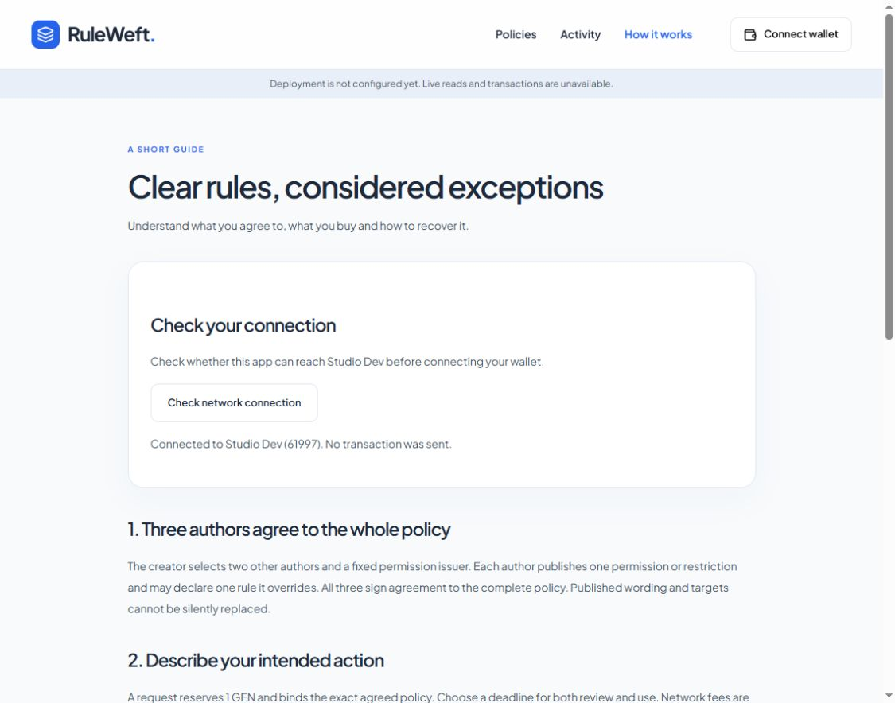

# Chrome integration verification

2026-10-20 UTC+7. Actual Chrome profile: Ca nhan1; local URL
http://127.0.0.1:5190/help. No application write or value transaction occurred.

The browser-control permission failure stopped after a later tool refresh;
its root cause is unknown. No setting, permission or security control was bypassed.

Commands and observed outputs:

- `cua.listBrowsers()` returned Chrome extension id3 and in-app browser id2.
- Click `Check network connection`: visible result
  `Connected to Studio Dev (61997). No transaction was sent.`
  The app used the actual same-origin RPC proxy, without Failed to fetch/CORS.
- Click `Connect wallet`: centered picker listed OKX Wallet and MetaMask.
- Owner unlocked/authorized OKX after its initial4001 rejection. The real app
  displayed account `0xc495...8272`; no signature/transaction proof is inferred.
- `tab.reload()`: same account restored through `eth_accounts`, no new prompt.
- Account button opened `OKX Wallet`, `Account & credits`, `Disconnect`.
  Clicking Disconnect changed the button to `Connect wallet`.
- Missing-address banner remained honest and writes unavailable.
- Latest `npm run check`:87 Python +10 Node +66 frontend =163 pass;
  semantic lint recognized one contract/18 methods, TypeScript/build successful.

This completes predeployment integration verification only. Actual deployed
canonical reads, signed browser writes and value exits are separate pending proof.
